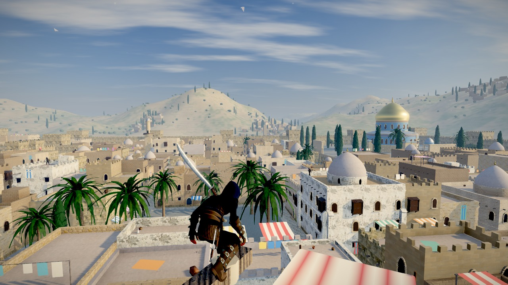
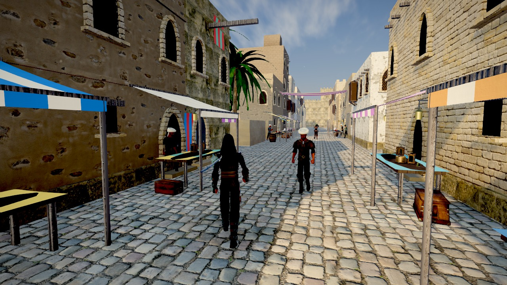
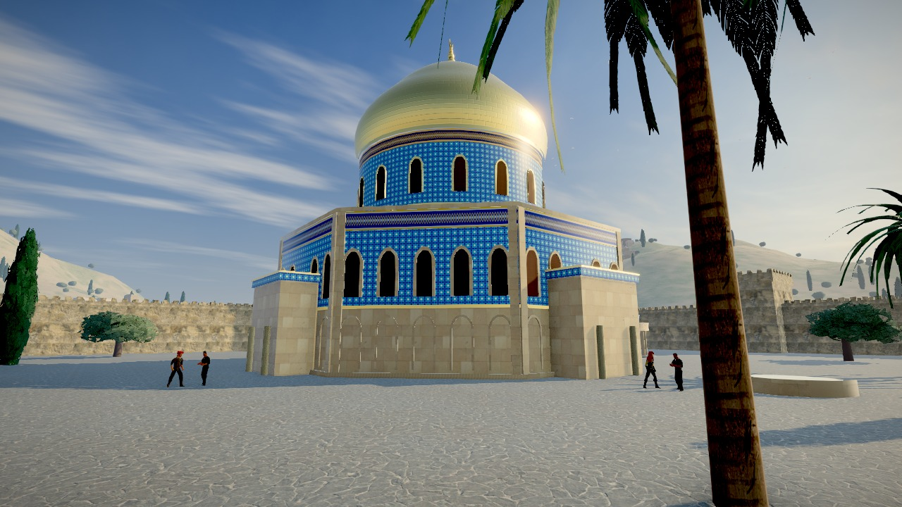

# KHANJAR — Jerusalem, 1187

An original third-person stealth-action game for PC, played in the browser. You are a hooded blade-for-hire
on the rooftops of a 12th-century Jerusalem: scale any wall, cross the city roof to roof, slip past (or cut
through) the garrison, and end the corrupt Castellan in his citadel — then vanish.



| | |
| --- | --- |
|  |  |

This is an original work in the open-world stealth/parkour genre. It does not use the name, characters,
story, art or levels of any existing game.

## Play

Requires Node 18+ and a desktop browser with WebGL 2 (Chrome, Edge or Firefox; a discrete GPU is recommended).

```bash
npm install
npm run dev        # then open http://localhost:5173
```

For an optimised static build: `npm run build` (output in `dist/`), then `npm run preview`.

## Controls

| Input | Action |
| --- | --- |
| **W A S D** / mouse | Move / look |
| **Shift** | Sprint — sprint into a wall to run up and climb it |
| **Space** | Jump · grab a wall mid-air · leap off while climbing |
| **C** | Crouch (harder to see) · let go while climbing · dodge-roll in a fight |
| **F** | Silent strike (behind an unaware guard) · leap strike (from above) · finish a staggered foe |
| **Left mouse** | Three-hit sabre combo |
| **Right mouse** | Block — raise it just before a blow lands to parry and stagger |
| **Q** | Draw / sheathe |
| **Alt** | Walk slowly |
| **Esc** | Pause · graphics quality · sound |

## How it plays

- **Free climbing.** Every wall, tower and dome is climbable. Hands and feet are placed with inverse kinematics.
- **Social stealth.** Guards ignore a calm walker. Sprinting, climbing, rooftops and bare steel draw their eyes;
  the citadel is forbidden ground. The eye at the top of the screen shows how exposed you are.
- **Three ways to kill.** A silent dagger strike from behind, a leap strike from a ledge above, or open duelling
  with combos, blocks, parries and finishers.
- **The mission.** Leave the lookout beam (the canopy below breaks your fall), cross the city to the citadel in
  the north-west, end Castellan Reynaud, then lose your pursuers and return to the watch-tower roof.

## Tech

- [three.js](https://threejs.org) with cascaded shadow maps, HDR image-based lighting, analytic height fog,
  ambient occlusion, bloom, god rays and filmic grading
- The whole district — streets, ~780 building lots, landmarks, hills — is generated procedurally at load
  (`src/world/`); collisions use a BVH (`three-mesh-bvh`)
- Characters share one skeleton and animation library; outfits are re-dyed at runtime (`src/cast.js`)
- All sound and music is synthesized with the Web Audio API (`src/audio.js`) — there are no audio files

`tools/` holds the asset pipeline (`build-characters.mjs`, `fetch-polyhaven.mjs`) and headless test helpers.

See [CREDITS.md](CREDITS.md) for asset sources — everything bundled is CC0 (public domain).
